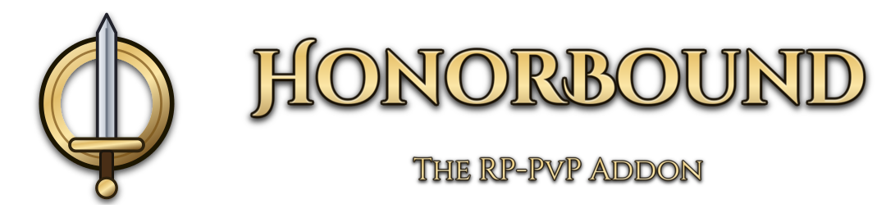

<b><a href="https://github.com/kaselby/rppvp/releases/latest/download/HonorBound.zip">Download HonorBound</a></b>

WoW Forever has no RP-PvP realms. HonorBound is how we build one anyway.

Swear the oath on a character and you stay flagged for PvP, for good. Every
other sworn player sees a crest on your portrait, your nameplate and your
name in chat, so you always know who has given their word, and who is fair
game.

## What it does

- **Keeps you flagged.** Once sworn, you can't turn PvP off from your portrait.
  If something unflags you, like leaving a dungeon, your next action bar
  key or click flags you again. Keep playing and you won't notice.
- **Gives you 5 minutes.** If you stay unflagged for 5 minutes, your oath
  breaks and your crest is gone. The clock waits while you're inside a
  dungeon or away from the keyboard.
- **Shows the crest.** Sworn players wear a blue (Alliance) or red (Horde)
  crest in place of the usual PvP icon (on portraits and party frames), on
  nameplates, and in chat. Hover it
  to see the level they swore at.
- **Can't be faked.** On portraits and nameplates, a crest only shows while
  the game says that player really is flagged. Inside dungeons and raids,
  where nobody can be flagged, sworn players keep their crest, and party
  members waiting outside still see it.

You only see crests on other players who also use HonorBound, so share it
with your guild and friends.

## Install

1. [Download HonorBound.zip](https://github.com/kaselby/rppvp/releases/latest/download/HonorBound.zip).
2. Open your WoW folder. In the Battle.net app, click the gear next to
   **Play** and choose **Show in Explorer** (or **Show in Finder** on Mac).
3. Go into **`_classic_beta_`**, then **`Interface`**, then **`AddOns`**.
   Create the folders if they're missing.
4. Unzip the download there. You should end up with an `AddOns\HonorBound`
   folder.
5. Restart WoW completely and make sure HonorBound is ticked in the AddOns
   list at character select.

## Swearing the oath

Log in and HonorBound asks if you want to swear on that character. Click
**Flag and swear** (or **Swear the oath** if you're already flagged) and
you're in. Choose **Not now** and you can swear any
time with `/honor swear`.

If your oath breaks, `/honor swear` takes it again, and your "since level"
starts over.

## Settings and commands

Settings are under Options > AddOns > HonorBound: reflagging with your
action bar keys, crests on nameplates and in chat, crest size, and how long
the popup waits after a dungeon.

| Type | To |
|---|---|
| `/honor` | See your oath and flag status |
| `/honor options` | Open the settings |
| `/honor swear` | Swear the oath on this character |
| `/honor renounce confirm` | Give up the oath |
| `/honor plates` | Turn crests on nameplates on or off |
| `/honor chat off` | Hide crests in chat (`on` to bring them back) |
| `/honor scale 1.2` | Make the crest bigger or smaller (0.6 to 2) |

## Good to know

- Your pledge is **verified** against your play time, like the Hardcore
  addon: Blizzard's `/played` keeps counting while HonorBound is off, so play
  it didn't see shows up. A little is allowed for crashes and other computers
  (2 hours, or 2% of your play since the pledge if that's more); beyond that
  **your oath breaks**. `/honor` shows where you stand.
- Your pledge and its verification are saved in a character macro called
  **HonorBound Save**, so they follow your character to other computers. Don't
  edit or delete it: an edited macro is ignored, and if it's gone your pledge
  only lives on this computer until HonorBound recreates it.
- Crests work across realms, but not across factions.
- Made by Moderately Aware, Krylea, Jmcq and Raffoo. Found a bug? [Open an issue](https://github.com/kaselby/rppvp/issues).
- Developers: see [docs/TECHNICAL.md](docs/TECHNICAL.md) for how discovery works, the message protocol and running the tests.
